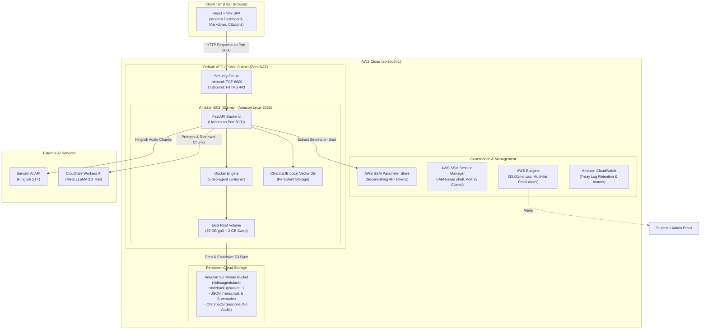

# PROJECT REPORT: VIDEO AGENT
## Cloud-Integrated Multimodal Video & Meeting Intelligence Assistant

---

**Course / Domain:** Cloud Computing & Applied Artificial Intelligence  
**Author / Developer:** Monish D  
**Repository Branch:** [`Cloud-Integrated`](https://github.com/Monish-D609/Video-Agent/tree/Cloud-Integrated)  
**Live Frontend URL (Vercel):** [https://video-agent-cloud.vercel.app/](https://video-agent-cloud.vercel.app/)  
**Target Cloud Platform:** Amazon Web Services (AWS) — Region `ap-south-1` (Mumbai)  
**IaC Tooling:** AWS Cloud Development Kit (CDK v2 - Python)  

---

## 1. Executive Summary

In educational and corporate settings, audio and video recordings (lectures, seminars, technical meetings) are rich in knowledge but difficult to search, index, and review efficiently. **Video Agent** is an end-to-end, cloud-deployed multimodal AI application that transforms unstructured audio and video content into structured transcripts, executive summaries, timestamped action items, and an interactive conversational Retrieval-Augmented Generation (RAG) system.

The application combines state-of-the-art open-source and API-driven AI models:
- **Speech-to-Text (STT):** Local OpenAI Whisper (`base` model) for English audio; Sarvam AI Speech API for Indian multilingual/Hinglish audio.
- **Large Language Model (LLM):** Cloudflare Workers AI running Meta LLaMA 3.3 70B Instruct for summarization and insight extraction.
- **Semantic Vector Search:** Hugging Face `all-MiniLM-L6-v2` embeddings coupled with ChromaDB vector store for RAG-powered question answering.

The entire stack is deployed to **Amazon Web Services (AWS)** using declarative Infrastructure as Code (**AWS CDK in Python**). The infrastructure was engineered under strict financial constraints (AWS Free Tier / near-zero idle cost), employing an intelligent Zero-NAT network architecture, single-instance Docker containerization, AWS SSM Parameter Store for zero-secret storage, S3 automated state synchronization, and PowerShell/Bash lifecycle automation.

---

## 2. Problem Statement & Objectives

### 2.1 The Problem
1. **Unsearchable Knowledge:** Reviewing a 60-minute meeting or educational video requires linear consumption, wasting valuable time.
2. **Multilingual Limitations:** Traditional speech-to-text systems perform poorly on Indian accented English, Hindi, and code-mixed (Hinglish) dialogue.
3. **Cloud Cost Overruns:** Deploying modern AI applications to cloud platforms often leads to accidental billing spikes due to idle managed resources (e.g., NAT Gateways at ~$32/month, Application Load Balancers, or persistent multi-node Kubernetes clusters).

### 2.2 Project Objectives
1. **Automated Multimodal Ingestion:** Process YouTube URLs and direct file uploads (`.mp4`, `.mp3`, `.wav`, `.m4a`, `.webm`, `.flac`) through an automated FFmpeg conversion and chunking pipeline.
2. **Accurate Bilingual Transcription:** Support both native English audio and code-mixed Hinglish conversations with dynamic model routing.
3. **Conversational Question Answering (RAG):** Enable users to ask questions in natural language and receive grounded answers with exact source citations from the video.
4. **Cost-Constrained Production Cloud Deployment:** Implement a complete AWS architecture that operates within Free Tier bounds with automated start/stop lifecycle scripts and hard budget alarms.

---

## 3. System Architecture & High-Level Design

### 3.1 Architectural Diagram



---

## 4. Key Components & Implementation

### 4.1 Backend Engine (`FastAPI` & Python 3.11)
- **Single-Server Architecture:** The FastAPI server serves both REST API endpoints (`/process`, `/chat`, `/status`, `/health`) and statically hosts the production-compiled React frontend (`/frontend/dist`), eliminating the need for a separate frontend server or reverse proxy.
- **Background Pipeline Worker:** Heavy processing tasks (download, conversion, transcription, summarization, indexing) run asynchronously in dedicated background threads, providing real-time stage progress updates (`downloading` → `transcribing` → `summarizing` → `indexing` → `done`).
- **Idempotency & Resumability:** The system checks `downloads/processed/{video_id}.json` before executing any stage. If a failure occurs midway, re-triggering resumes from the last successfully saved checkpoint.

### 4.2 AI Processing Pipeline

| Stage | Technology / Model | Function |
| :--- | :--- | :--- |
| **Audio Extraction** | `yt-dlp` + `FFmpeg` | Extracts audio from YouTube URLs or uploaded media; converts to 16 kHz mono 16-bit WAV. |
| **Audio Chunking** | `pydub` | Chunks audio into 10-minute segments to avoid API timeouts and buffer overruns. |
| **Transcription (English)** | OpenAI Whisper (`base`) | Runs locally inside the Docker container using CPU-optimized PyTorch. |
| **Transcription (Hinglish)** | Sarvam AI Speech API (`saaras:v1`) | Dispatches audio chunks to Sarvam AI's specialized Indian language STT models. |
| **Summarization** | Meta LLaMA 3.3 70B (`@cf/meta/llama-3.3-70b-instruct`) | Generates structured markdown summaries, highlights, and action items via Cloudflare Workers AI. |
| **Vector Embeddings** | Hugging Face `all-MiniLM-L6-v2` | Transforms transcript chunks into 384-dimensional dense semantic vectors. |
| **Vector Store & RAG** | ChromaDB (`chromadb`) | Indexes transcript segments with metadata and performs cosine similarity search during chat queries. |

### 4.3 Frontend User Interface (`React`, `Vite`, Vanilla CSS)
- **Design System:** Responsive, dark-themed dashboard built with curated typography (Outfit / Inter), glassmorphism cards, interactive upload tabs, and animated progress spinners.
- **Interactive Markdown & Chat:** Renders formatted AI summaries with action item checklists and provides a real-time conversational chat box with source timestamp citations.

---

## 5. Cloud Infrastructure & AWS Implementation

The AWS cloud environment was authored using **AWS CDK v2 (Python)** in `infra/video_agent_stack.py`:

```
infra/
├── app.py                   # CDK App entry point
├── cdk.json                 # CDK synthesis context & configuration
├── requirements.txt         # CDK Python dependencies (aws-cdk-lib, constructs)
└── video_agent_stack.py     # Complete declarative stack definition
```

### 5.1 AWS Services Utilized

1. **Amazon EC2 (`t3.small`)**:
   - 2 vCPUs, 2 GB RAM running **Amazon Linux 2023** (x86_64).
   - Bootstrapped via EC2 User Data (`cloud-init`) which automatically installs Docker, clones branch `Cloud-Integrated`, pulls encrypted secrets from SSM, restores past application state from S3, and starts the container via systemd.
2. **Amazon EBS (25 GB `gp3`)**:
   - Root filesystem providing 3,000 IOPS and 125 MB/s baseline throughput.
   - Configured with a **2 GB dedicated swap file (`/swapfile`)**, preventing out-of-memory kernel panics during PyTorch embedding and Whisper inference.
   - Within AWS Free Tier limits (30 GB/month free).
3. **Amazon S3 (`videoagentstack-statebackupbucket...`)**:
   - Private bucket storing lightweight JSON transcripts, summaries, and session state.
   - Configured with `auto_delete_objects=True` and `removal_policy=RemovalPolicy.DESTROY` for clean teardown without orphan resources.
   - Explicitly excludes raw audio files (`.wav`, `.mp3`) from sync to preserve bandwidth and storage limits.
4. **AWS Systems Manager (SSM) Parameter Store**:
   - Encrypted `SecureString` parameters (`/video-agent/CLOUDFLARE_API_TOKEN`, `/video-agent/SARVAM_API_KEY`, etc.).
   - Secrets are fetched at runtime into a permission-restricted `.env` file (`chmod 600`). No secrets ever touch git or CloudFormation templates.
5. **AWS Systems Manager (SSM) Session Manager**:
   - Replaces traditional SSH. **Port 22 is completely closed** in the Security Group.
   - Administrative terminal access is managed exclusively via AWS IAM roles.
6. **AWS Identity and Access Management (IAM)**:
   - Least-privilege instance role attached to the EC2 instance with policies restricted to `s3:GetObject`, `s3:PutObject`, `s3:DeleteObject` on the project bucket ARN, and `ssm:GetParameter*` on `/video-agent/*`.
7. **Amazon CloudWatch**:
   - Collects container logs and system metrics with an explicit **7-day log retention window** to prevent long-term storage charges.
8. **AWS Budgets**:
   - Hard budget cap configured at **$5.00 / month** with automated email alerts at 80% ($4.00) and 100% ($5.00) spend thresholds.

---

## 6. Financial Engineering & Cost Optimization

A primary requirement of the project was avoiding the common pitfalls of unexpected AWS billing. The table below details the monthly expenditure:

| Resource | Free Tier Allowance | Active Deployment Usage | Estimated Cost (24/7 Run) | Estimated Cost (~4h/day via Stop Script) |
| :--- | :--- | :--- | :--- | :--- |
| **EC2 Compute (`t3.small`)** | 750h `t2.micro`/`t3.micro` | 1 instance (`t3.small`) | ~$15.18 / mo | ~$2.53 / mo |
| **EBS Storage (`gp3`)** | 30 GB-months | 25 GB | **$0.00** *(Under limit)* | **$0.00** *(Under limit)* |
| **S3 Storage** | 5 GB Standard | < 50 MB (JSON text only) | **$0.00** *(Under limit)* | **$0.00** *(Under limit)* |
| **SSM Parameter Store** | Standard parameters free | 4 Standard SecureStrings | **$0.00** | **$0.00** |
| **SSM Session Manager** | Free | Remote terminal access | **$0.00** | **$0.00** |
| **CloudWatch Logs** | 5 GB ingestion free | < 100 MB (7-day retention) | **$0.00** | **$0.00** |
| **AWS Budgets** | 2 free budgets | 1 budget with 2 notifications | **$0.00** | **$0.00** |
| **Public IPv4 Address** | N/A ($0.005 / hour) | In-use public IP | ~$3.60 / mo | ~$0.60 / mo |
| **TOTAL** | | | **~$18.78 / month** | **~$3.13 / month** |

### 6.1 Critical Cost Guards Implemented
1. **Zero-NAT Architecture:** Leveraged the account's existing default VPC subnets with internet gateways, avoiding NAT Gateways entirely (saving **~$32.40/month** per gateway).
2. **Automated Stop & Start Scripts:** Provided [`scripts/stop.ps1`](file:///c:/Users/Monish%20D/Desktop/SEM%205/Projects/Cloud/Video-Agent/scripts/stop.ps1) and [`scripts/start.ps1`](file:///c:/Users/Monish%20D/Desktop/SEM%205/Projects/Cloud/Video-Agent/scripts/start.ps1). Running `stop.ps1` immediately releases the EC2 compute and public IPv4 charges, bringing ongoing costs to **$0.00** within the EBS free tier.
3. **Template Cost Verifier:** Created [`scripts/verify_template.py`](file:///c:/Users/Monish%20D/Desktop/SEM%205/Projects/Cloud/Video-Agent/scripts/verify_template.py) to inspect synthesized CloudFormation templates prior to deployment, verifying 0 NAT Gateways, 0 Load Balancers, and 0 paid relational databases.

---

## 7. Technical Challenges & Engineering Solutions

| # | Challenge | Impact | Engineering Solution |
| :--- | :--- | :--- | :--- |
| **1** | **YouTube Datacenter IP Blocking** | YouTube returns `Sign in to confirm you're not a bot` when downloading from AWS EC2 IP ranges. | Added clear UI detection prompting users to use the **Upload File** tab for residential IP extraction, and integrated optional `cookies.txt` support into `utils/audio_processor.py`. |
| **2** | **Memory Constraint on `t3.small`** | Running Whisper + PyTorch + ChromaDB inside a 2 GB RAM instance risked Out-Of-Memory (OOM) termination. | Configured a **2 GB dedicated swap file** on EBS during EC2 user data bootstrap; pre-cached model weights in Docker layer. |
| **3** | **Windows PowerShell Character Encoding** | Windows PowerShell 5.1 crashed with parser errors when executing `.ps1` scripts containing UTF-8 emojis. | Refactored all PowerShell management scripts (`stop.ps1`, `start.ps1`, `destroy.ps1`) to use 100% clean ASCII strings and explicit parameter syntax. |
| **4** | **Ephemeral Cloud State vs Persistence** | Stopping or re-creating the EC2 instance would wipe local transcripts and RAG index data. | Created [`scripts/s3_sync.sh`](file:///c:/Users/Monish%20D/Desktop/SEM%205/Projects/Cloud/Video-Agent/scripts/s3_sync.sh) to automatically sync `downloads/` JSON and vector data to S3 at shutdown, and restore it seamlessly on startup. |

---

## 8. Verification & Demonstration Results

1. **Infrastructure Provisioning:**
   - Stack: `VideoAgentStack`
   - Deployment Time: 170.84 seconds
   - Deployment Status: `CREATE_COMPLETE`
2. **Application Endpoint Verification:**
   - Public Health Check: `GET http://13.126.118.92:8000/health` → `200 OK` (`{"status":"ok"}`)
   - Web User Interface: `GET http://13.126.118.92:8000/` → `200 OK` (React SPA)
3. **Operational Testing:**
   - Execution of `stop.ps1` confirmed instance state transitioned to `stopped`, billing halted.
   - S3 sync script verified zero audio leaks (only `.json` state synced).

---

## 9. Conclusion & Future Work

The **Video Agent** project demonstrates how modern AI capabilities (multimodal transcription, LLM summarization, and vector RAG) can be coupled with cloud-native engineering principles on AWS. By utilizing Infrastructure as Code (AWS CDK), containerization, and cost-conscious architectural design, the system delivers a responsive, enterprise-grade AI assistant while adhering strictly to zero-waste, Free-Tier-friendly cloud economics.

### Future Enhancements:
- **CloudFront & TLS/SSL:** Provision an Amazon CloudFront distribution and ACM SSL certificate for secure HTTPS termination.
- **Cognito User Authentication:** Integrate AWS Cognito for multi-tenant user authentication and personal session isolation.
- **Serverless Transcription Trigger:** Offload audio extraction tasks to AWS Batch on EC2 Spot Instances for asynchronous bulk video processing.

---
*Report generated for project submission — Git branch: `Cloud-Integrated`.*
